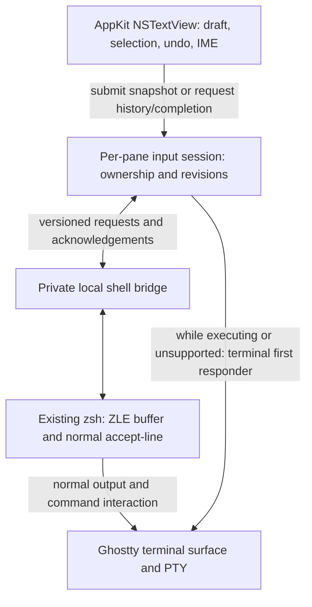

# Native command input for the Patina Ghostty fork

Status: macOS prototype implemented; the broader design below is the intended
direction. See [the prototype guide](../prototype/native-input/README.md) for the
implemented scope, launch instructions, tests, and limitations.

Repository: [patinasystems/ghostty](https://github.com/patinasystems/ghostty).
Source inspection baseline, 2026-11-02:
[`0b1729e945978fca4bcd6165d8ac408bf675a7f2`](https://github.com/ghostty-org/ghostty/commit/0b1729e945978fca4bcd6165d8ac408bf675a7f2).
Links into upstream below are pinned to that revision. The prototype adds a
native per-pane editor and an isolated local-zsh adapter without changing the
terminal core.

## Prototype versus final design

The prototype uses private, atomically published request/state/receipt files and
a dedicated ZLE key widget. The app sends the complete draft through the private
file, then sends only the widget trigger through Ghostty. The widget validates
the generation and request ID, assigns `BUFFER`, and invokes `.accept-line`.
Native drafts are retained until an acceptance receipt; old prompt generations
cannot reactivate the editor after acceptance.

This choice followed a disposable FD-callback experiment: `zle -F -w` could
modify `BUFFER`, but `accept-line` inside that callback did not advance macOS zsh
5.9's input loop without a PTY wake. Moving acceptance into a normal key widget
worked in the committed PTY integration suite. A side-channel-only production
handoff remains unproven. The prototype's readiness-to-trigger race and 100 ms
file polling are explicitly documented in its guide.

History and completion use the ordinary terminal via **Use Terminal**. User
startup/plugin integration, syntax coloring, remote shells, and Linux remain
future work. The socket/FD protocol, capabilities, and broader compatibility
gates described below are proposals, not claims about the current prototype.

## Decision

Add a real AppKit `NSTextView` command editor to each terminal pane. It owns the
unsubmitted command, selection, undo history, and text composition. Keep Ghostty
for terminal rendering, PTY management, and input to running programs. Start
with a directly spawned local zsh and a small, explicit shell adapter.

This is a change to who owns the command buffer. Keybindings alone cannot supply
the requested native editing behavior: the current prompt is edited by the shell,
whereas terminal selection refers to rendered output. Ghostty's upstream
[text-editor input discussion](https://github.com/ghostty-org/ghostty/discussions/9985)
and [Warp-like selection discussion](https://github.com/ghostty-org/ghostty/discussions/6916)
describe the same distinction.

Use Warp's [documented editing behavior](https://docs.warp.dev/terminal/editor/)
as a product reference. Build the editor with AppKit's
[native text system](https://developer.apple.com/documentation/appkit/nstextview).
There is no need to replace Ghostty's renderer or adopt Warp's application stack.

## Behavior contract

| Interaction                             | Required behavior                                                                                             |
| --------------------------------------- | ------------------------------------------------------------------------------------------------------------- |
| Click, drag, double-click, triple-click | Native cursor placement and text selection, including across lines and wraps.                                 |
| Shift+arrows; Option/Cmd+Shift+arrows   | Native character, word, and line selection.                                                                   |
| Type or delete with a selection         | Replace or delete the selected range.                                                                         |
| Cmd+A/C/X/V/Z and redo                  | Act on the editor when it has focus; preserve normal terminal behavior when the terminal has focus.           |
| Enter                                   | Submit one complete command buffer, except while an IME composition is active.                                |
| Shift+Enter                             | Insert a literal newline. Option/Control+Enter can be supported as Warp-compatible aliases.                   |
| Paste                                   | Insert editable plain text without execution. Preserve multiline content for review.                          |
| Up/Down                                 | Navigate visual rows. History navigation must not take over movement inside a multiline draft.                |
| Unicode                                 | Correct selection and editing of emoji, combining marks, non-Latin text, and marked text.                     |
| Accessibility                           | Expose an editable text control through AppKit, with selection and caret information.                         |
| Command running                         | Give ordinary keyboard and mouse input to Ghostty, including inline prompts, REPLs, and full-screen programs. |

Selection highlighting is required immediately. Shell syntax coloring is a
separate feature: color tokens without changing text, selection, undo grouping,
or IME composition. AppKit supplies text editing, not a shell parser or
command-validity checker. Warp likewise documents
[syntax/error highlighting](https://docs.warp.dev/terminal/editor/syntax-error-highlighting)
separately from selection.

Disable automatic smart quotes, smart dashes, and substitutions that change shell
syntax. Do not rebuild `NSTextView.string` on each SwiftUI update: that would
discard selection, composition, and undo state. Keep one authoritative native
text storage and publish versioned snapshots only when needed.

## Existing code and extension points

| Area                       | Current source                                                                                                                                                                                                                                                                                                                                                               | What changes                                                                                                                                      |
| -------------------------- | ---------------------------------------------------------------------------------------------------------------------------------------------------------------------------------------------------------------------------------------------------------------------------------------------------------------------------------------------------------------------------- | ------------------------------------------------------------------------------------------------------------------------------------------------- |
| Pane layout                | [`SurfaceWrapper`](https://github.com/ghostty-org/ghostty/blob/0b1729e945978fca4bcd6165d8ac408bf675a7f2/macos/Sources/Ghostty/Surface%20View/SurfaceView.swift#L7)                                                                                                                                                                                                           | Add a bounded, growing editor region in the pane layout. Reserve space rather than covering terminal output.                                      |
| Terminal input             | [`SurfaceView_AppKit.swift`](https://github.com/ghostty-org/ghostty/blob/0b1729e945978fca4bcd6165d8ac408bf675a7f2/macos/Sources/Ghostty/Surface%20View/SurfaceView_AppKit.swift#L1120)                                                                                                                                                                                       | Leave its key encoding and `NSTextInputClient` path for terminal input. The new editor receives normal AppKit editing events.                     |
| Focus                      | [`focusDidChange`, `becomeFirstResponder`](https://github.com/ghostty-org/ghostty/blob/0b1729e945978fca4bcd6165d8ac408bf675a7f2/macos/Sources/Ghostty/Surface%20View/SurfaceView_AppKit.swift#L445), and `Ghostty.moveFocus` in `SurfaceView.swift`                                                                                                                          | Resolve the desired first responder from the pane's input state. Distinguish active pane from active child view.                                  |
| Shortcut routing           | [`BaseTerminalController.swift`](https://github.com/ghostty-org/ghostty/blob/0b1729e945978fca4bcd6165d8ac408bf675a7f2/macos/Sources/Features/Terminal/BaseTerminalController.swift#L1429)                                                                                                                                                                                    | Its command-palette handling already documents stale terminal focus stealing paste. Cover the same case for the new editor.                       |
| Existing text APIs         | [`Ghostty.Surface.sendText/pasteText`](https://github.com/ghostty-org/ghostty/blob/0b1729e945978fca4bcd6165d8ac408bf675a7f2/macos/Sources/Ghostty/Ghostty.Surface.swift#L47), [`Surface.textCallback`](https://github.com/ghostty-org/ghostty/blob/0b1729e945978fca4bcd6165d8ac408bf675a7f2/src/Surface.zig#L3421)                                                           | These paste text; neither sets and accepts a shell command buffer. Add a distinct submission path.                                                |
| Prompt events              | [`StreamHandler.semanticPrompt`](https://github.com/ghostty-org/ghostty/blob/0b1729e945978fca4bcd6165d8ac408bf675a7f2/src/termio/stream_handler.zig#L1473)                                                                                                                                                                                                                   | OSC 133 C/D become command events. B updates the terminal model without a host readiness event. Do not confuse a prompt delimiter with ownership. |
| Command lifecycle          | [`Surface.zig`](https://github.com/ghostty-org/ghostty/blob/0b1729e945978fca4bcd6165d8ac408bf675a7f2/src/Surface.zig#L1194), [`Ghostty.App.swift`](https://github.com/ghostty-org/ghostty/blob/0b1729e945978fca4bcd6165d8ac408bf675a7f2/macos/Sources/Ghostty/Ghostty.App.swift#L773)                                                                                        | Existing `command_finished` is useful for timing, but does not mean the shell line editor is ready.                                               |
| Shell bootstrap            | [`shell_integration.zig`](https://github.com/ghostty-org/ghostty/blob/0b1729e945978fca4bcd6165d8ac408bf675a7f2/src/termio/shell_integration.zig), [`ghostty-integration`](https://github.com/ghostty-org/ghostty/blob/0b1729e945978fca4bcd6165d8ac408bf675a7f2/src/shell-integration/zsh/ghostty-integration)                                                                | Negotiate the new adapter for the directly spawned zsh. Preserve existing hooks and per-file notices.                                             |
| Configuration / C boundary | [`Config.zig`](https://github.com/ghostty-org/ghostty/blob/0b1729e945978fca4bcd6165d8ac408bf675a7f2/src/config/Config.zig), [`action.zig`](https://github.com/ghostty-org/ghostty/blob/0b1729e945978fca4bcd6165d8ac408bf675a7f2/src/apprt/action.zig), [`ghostty.h`](https://github.com/ghostty-org/ghostty/blob/0b1729e945978fca4bcd6165d8ac408bf675a7f2/include/ghostty.h) | Add an opt-in setting and only the lifecycle/API additions actually needed. Keep C/Zig tags and payloads consistent.                              |

### Why paste plus Enter is insufficient

The inspected [`paste.zig`](https://github.com/ghostty-org/ghostty/blob/0b1729e945978fca4bcd6165d8ac408bf675a7f2/src/input/paste.zig#L46)
changes LF to CR without bracketed paste and replaces selected control bytes with
spaces. `sendText` bypasses paste confirmation; `pasteText` can wait for an
asynchronous confirmation. A separately sent Enter does not acknowledge either
successful insertion or shell readiness. Multiline commands, rejected pastes,
and an unexpected foreground program make this approach unreliable.

Likewise, running each submission in a new `zsh -c`, splitting it into lines, or
wrapping it in `eval` does not preserve the ordinary interactive shell contract.
The existing session must retain `cd`, exports, aliases, functions, history, and
job control.

## Proposed architecture

Keep the editor and focus/session state on `MainActor`. Transport I/O and optional
syntax parsing must not block AppKit. Pass immutable, versioned snapshots across
isolation boundaries; discard stale results. Avoid sharing the text storage
with a background worker.

Proposed new components, with names to finalize during implementation:

- `macos/Sources/Features/Command Input/CommandInputView.swift`: an
  `NSViewRepresentable` wrapper for an `NSScrollView` and `NSTextView`.
- `CommandTextView.swift`: small overrides for submit/newline and composition
  guards; otherwise use AppKit editing commands.
- `CommandInputSession.swift`: per-pane draft lifetime, ownership, acknowledgement,
  and focus decisions. No process execution in the view.
- `CommandInputTransport.swift`: bounded framing and channel lifecycle, with a
  narrow shell adapter interface.
- A separate zsh adapter loaded by the existing integration only when the feature
  is enabled and a bridge capability is available.

For the first macOS implementation, keep the private transport near the native
host and inject its bootstrap data when creating the surface. If it needs core
process lifecycle support, add a small embedded API rather than teaching the
renderer about editable documents. A future GTK host can reuse the protocol.

### Input ownership

| State                        | Keyboard owner                                  | Transition                                                              |
| ---------------------------- | ----------------------------------------------- | ----------------------------------------------------------------------- |
| Unsupported / disconnected   | Ghostty terminal                                | A supported shell negotiates a live bridge.                             |
| Ready / editing              | Native editor when that pane is focused         | Submit a versioned snapshot, or explicitly yield to ZLE.                |
| Submitting                   | Freeze this draft; prevent duplicate submission | Receive acceptance or a definite rejection.                             |
| Executing                    | Ghostty terminal                                | Shell reports a new, valid top-level editable prompt.                   |
| Shell editing / continuation | Ghostty terminal                                | Explicit resynchronization returns an authoritative buffer.             |
| Desynchronized               | Ghostty terminal; preserve recovery draft       | Reconnect and establish a fresh generation. Never replay automatically. |

An acceptance acknowledgement means the shell has accepted ownership of this
snapshot; it is not an exit result. Retain a recoverable copy through uncertain
handoffs. An unknown outcome must never cause automatic resubmission.

OSC 133 D can precede prompt hooks and line-editor initialization. B can appear
on redraw or continuation. Arbitrary programs can print either sequence. Use
them for terminal semantics, not as the sole authority to acquire input.
Foreground PID and alternate-screen state are useful additional checks, not
substitutes for a live adapter handshake.

When the adapter withdraws readiness, return input to Ghostty before the program
can request input. This includes `read`, password prompts, and REPLs that never
enter an alternate screen. A new prompt in an unfocused pane must not steal focus.

### Local zsh bridge

The [Zsh Line Editor documentation](https://zsh.sourceforge.io/Doc/Release/Zsh-Line-Editor.html)
provides the necessary primitives: `BUFFER`, `CURSOR`, `CONTEXT`, `accept-line`,
and `zle -F -w` file-descriptor widget callbacks. The production integration
still needs an end-to-end implementation and qualification.

1. At shell startup, negotiate a versioned, private per-surface channel. Restrict
   the endpoint to the user and bind it to the launched shell session. Do not
   accept bridge requests from arbitrary printed terminal output.
2. Register an FD callback while the supported top-level ZLE context is active.
   Continuation, `vared`, shell widgets, shell replacement, and nested shells
   require explicit handling; initially yield to the terminal.
3. The app sends the complete UTF-8 snapshot through the side channel, not as
   terminal keystrokes. Include protocol version, shell session, prompt generation,
   request ID, draft revision, and explicit byte lengths.
4. The adapter validates ownership and framing, assigns `BUFFER` and `CURSOR`,
   acknowledges acceptance, then invokes the normal `accept-line` path. It must
   not evaluate transport framing or interpolate payload into generated shell
   source. Preserve all supported bytes and reject unsupported input explicitly.
5. Invalidate readiness before accepting the line. Restore it only when the
   shell has actually reentered a supported editable context. Reject stale or
   duplicate request IDs; do not queue a second command for a future prompt.

Bound frame sizes and partial-frame buffering; an FD becoming readable does not
guarantee a complete message. Never block the shell event loop waiting for the
rest of a malformed frame. Define EOF, timeout, shutdown, cancellation, and
oversize behavior. Preserve trailing newlines and embedded tabs; reject NUL
rather than silently truncating it. A simple probe can use simpler framing, but
that is not the production protocol.

Wire cursor offsets should be UTF-8 byte offsets at valid text boundaries. AppKit
uses UTF-16 ranges; zsh's indexing has its own character semantics. Convert
explicitly and test emoji and combining marks. Never send an `NSRange` as a shell
cursor position.

Completion and shell widgets can intentionally yield ownership. Transfer the
draft once, let ZLE edit, then import the resulting authoritative snapshot under
a new revision. Do not mirror every edit into synthetic arrow/backspace events.

## History, completion, and prompt display

History must come from the active shell session, respecting its history policy.
Reading `~/.zsh_history` alone misses in-memory commands and shell settings.
Choose an explicit key policy: Up/Down stays native within the draft, with
history at the first/last visual row or through a dedicated history shortcut.
Warp's [history UI](https://docs.warp.dev/terminal/entry/command-history/) is a
reference, not something AppKit supplies automatically.

Tab completion is the largest compatibility question after submission. Existing
user ZLE widgets and completion plugins cannot transparently edit an app-owned
buffer. Implement a documented yield-to-shell/import-buffer path first. A native
completion menu needs candidates, replacement ranges, quoting, cancellation,
and revision checks from a shell-aware provider. A fresh background shell is not
equivalent to the current shell. Full parity with Warp's
[completion UI](https://docs.warp.dev/terminal/command-completions/completions/)
is a later gate.

Initially reserve an editor strip below the terminal and retain the ordinary
shell prompt in the terminal. Make it clear which region is editable. Record the
accepted command in the terminal through the shell's normal redisplay/acceptance
behavior; verify that it appears exactly once. Do not hide terminal rows based
on guessed prompt geometry. Inline placement and structured output blocks can
be considered after input ownership works.

SSH, tmux, nested shells, and `exec zsh` continue through Ghostty until their
actual shell negotiates support. Warp documents
[SSH](https://docs.warp.dev/terminal/warpify/ssh/) and
[subshell](https://docs.warp.dev/terminal/warpify/subshells) integration as separate
capabilities; they are not free consequences of a native editor.

## Implementation sequence and release gates

| Stage                       | Deliverable                                                                                                                  | Evidence required before proceeding                                                                                      |
| --------------------------- | ---------------------------------------------------------------------------------------------------------------------------- | ------------------------------------------------------------------------------------------------------------------------ |
| 0. Establish fork build     | Reproducible macOS baseline; separate Patina app identity and configuration/update policy before installing beside upstream. | Build and launch the unchanged baseline. Use source-pinned tool versions.                                                |
| 1. Native editing           | Opt-in editor per pane; mouse/keyboard selection, multiline input, clipboard, undo, IME, accessibility.                      | Native interaction tests and manual IME/VoiceOver checks. An editor-only demo is not an integrated terminal.             |
| 2. Local zsh submission     | Negotiated bridge, complete-buffer acceptance in the live shell, running-program handoff, fresh-prompt recovery.             | PTY tests for exact payloads, persistent state, incomplete input, stale requests, disconnects, and interactive programs. |
| 3. Daily-use shell behavior | History and completion handoff, cancellation, continuation handling, prompt-plugin coexistence.                              | Test supported plugin configurations and normal zsh history/job semantics. State unsupported widgets explicitly.         |
| 4. Polish                   | Syntax colors, native completion candidates where supported, theme/font consistency, layout and focus behavior.              | No selection/undo/IME regressions; stable panes during asynchronous output.                                              |
| 5. Broader support          | Fish/Bash adapters, remote and nested sessions, then GTK native editor.                                                      | Qualify each environment independently. Do not infer support from local zsh results.                                     |

The smallest useful app milestone is stages 0–2, with history/completion limits
visible. The requested everyday editing experience needs stage 3 as well.
There is no claim that a one-file UI patch achieves Warp parity.

Build facts at the pinned revision:

- `build.zig.zon` requires Zig `0.17.0`; `src/build/zig.zig` enforces matching
  major/minor. The public build webpage still lists older tip requirements, so
  use the checked-out source and its Nix lock as authority.
- `HACKING.md` says Xcode 26/macOS 26 SDK; the current macOS CI selects Xcode
  27.1. A successful baseline build must settle the supported local setup.
- Follow `macos/AGENTS.md`: build changed core code with
  `zig build -Demit-macos-app=false`, build the app with `macos/build.nu`, and
  run its unit tests with `macos/build.nu --action test`. That test command
  skips UI tests; UI/IME validation is additional work.
- Upstream CI references its own runners and secrets. Configure fork CI
  deliberately before relying on it. Do not assume a fork inherits its runner
  access or signing setup.
- Existing release bundle IDs and updater feeds identify upstream Ghostty.
  Before distributing the fork, give it a distinct app identity and explicitly
  disable or replace the upstream update feed.

## Acceptance matrix

| Area               | Cases                                                                                                                                                                   |
| ------------------ | ----------------------------------------------------------------------------------------------------------------------------------------------------------------------- |
| Native editing     | Select/replace across hard and soft wraps; extend selection by word/line; undo/redo across paste and newline; drag/autoscroll; native clipboard and Services.           |
| Text fidelity      | Emoji, combining marks, CJK, bidirectional text, tabs, quoted newlines, heredocs, trailing newlines, empty input, large paste, rejected unsupported bytes.              |
| Composition        | Japanese/Chinese IME candidate confirmation must not submit. Focus changes and syntax coloring must preserve marked text.                                               |
| Shell semantics    | `cd`, exports, functions, aliases, multiline pipelines, history expansion, shell history options, job control, incomplete syntax, `Ctrl+C`, empty command, shell exit.  |
| Foreground input   | `read`, `sudo`, Python/other REPL, Vim, mouse reporting, Kitty keyboard protocol, SSH and tmux fallback.                                                                |
| Ownership          | Delayed acknowledgement, duplicate/stale request, old prompt generation, disconnect before/after acceptance, truncated/oversize frame, background output while editing. |
| Window behavior    | Multiple panes/windows, switch/close pane, search, command palette, quick terminal, app activation, secure input, restoration.                                          |
| User configuration | Prompt frameworks and async prompts, custom ZLE widgets, vi/emacs shell keymaps, manually sourced `.zshrc`, disabled shell integration.                                 |

Use unit tests for ownership and framing, PTY integration tests for shell
semantics, AppKit/UI tests for first-responder and editor behavior, and manual
checks for IME and assistive technology. Success in one layer does not prove the
others. Preserve the normal Ghostty path as the fallback throughout development.
