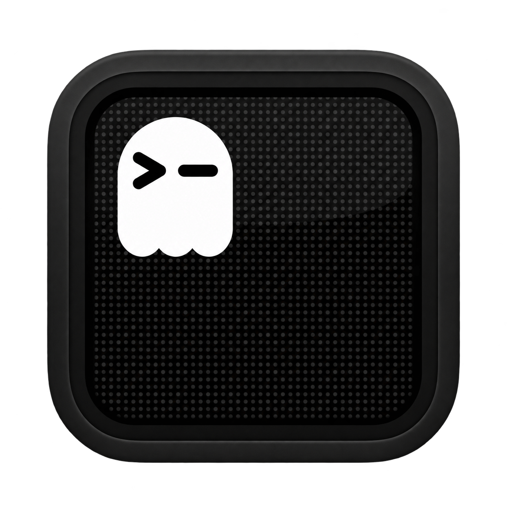

# Spooky black icon variant

An AI-assisted monochrome variant of Ghostty's original CRT/ghost icon:
charcoal bezel, black screen, gray phosphor dots, and white ghost. The reference
is [`macOS-AppIcon-1024px.png`](../../macos/Assets.xcassets/AppIconImage.imageset/macOS-AppIcon-1024px.png).

`icon-black.png` is a 1254 × 1254 PNG with transparency, generated on 2026-11-03.
It is a separate visual concept, not an exact pixel recolor or a replacement for
the app's compiled icon asset. The upstream icon assets remain intact. Before
shipping it as the default app icon, export the platform icon sizes, inspect the
Dock and Finder at small sizes, and include it in the signed app before notarizing.

Original Ghostty artwork and project attribution are retained under the
repository's [license](../../LICENSE). This variant identifies the independent
Spooky fork; it does not imply Ghostty's endorsement.
